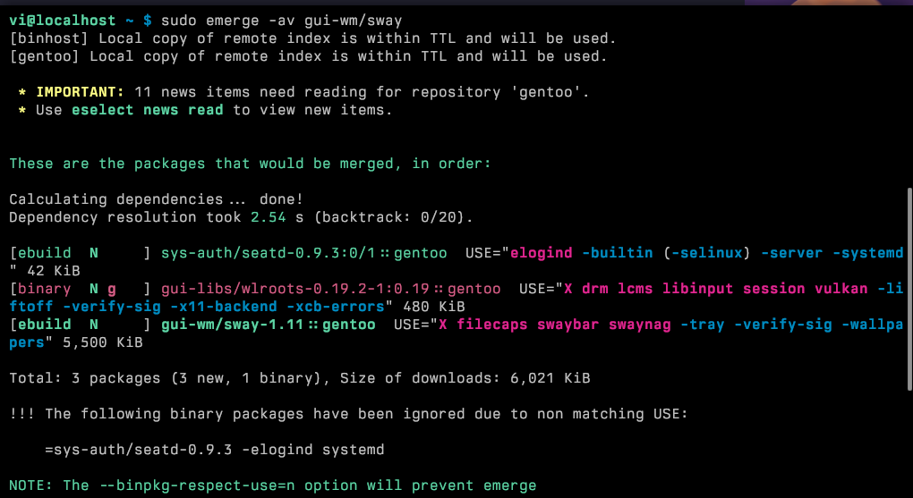

"if gentoo is so good, where's genthree?"

# why...

I decided to pull out some of my spare laptops today and try out some other OSes.
genuinely, I do not think i have any other use for that many. initial plan was to have a kind of combination
the first on my list was Gentoo! so here we are.

i initially didn't know much about it other than
1. it takes really long to compile everything
2. systemD is Optional. which is pretty intriguing, so i tried that out.
# installation
I pulled up "gentoo iso" and was greeted w either a graphical or terminal installer. i was an arch lover by heart, so i just decided eh why not. Command Install let's go

the process itself was fairly straightforward, and very very similar to Arch. hell it even included arch-chroot as one of the steps which i found pretty comical. it was also the first time i was exposed to using Portage / Emerge, the package manager of Gentoo. like duh what was i expecting... but honestly it was pretty useful in letting me know ab some things other managers don't. 

for example:
1. I had to figure out that i had to edit package.licenses in /etc/portage to agree to the Linux kernel license. which i thought was automatic, but apparently not. i mean I could just automatically agree to them all, but eh
2. i had to Manually Search the timestamp for the stage3 tar file i needed

for reference, I used this gist and not the actual handbook because I got too lazy to read through everything and decide what I needed: https://gist.github.com/andrewward2001/bfe2f296d6486d2d4892c6de5587db1b

am i lazy Yes but at least im doing it myself :D and it worked out in the end. Whatever .

# package management
So. `emerge`. sidenote why is it called emerge when the other name is portage Ok Whatever.

Despite having a kind of a bad rep (to me at least) that "everything has to be compiled", it really only is if you decide to be a contrarian and set flags that aren't the default. The defaults are pretty sane (O2) and actually has a binary cache host starting Dec 2023, w/ 'faster' x64 being Feb 2024. So yeah, verrrry recent. given that I made my choice for Arch back in 2018 (and went down the suffering rabbit hole).

The syntax for it is relatively simple, but not really.
## emerge
* emerge --ask --verbose (-av) -> install, shows flags that are defaulted.
	* for example, here is what happens if i try installing like. sway:

* emerge --sync -> apt autoupdate
* emerge --unmerge xxx -> uninstall
* emerge --depclean -> autoremove
* emerge -uDN -> upgrade, deep, newuse

a useful tool that my Slop Clod told me about was eix. essentially indexes and searches stuff a helluva lot faster than emerge --search does. looks cool!

to set it up, same as any other package, but u gotta sync it w emerge's database first.
 * `emerge -av app-portage/eix`
 * `eix-update`
## USE flags
the main thing that Gentoo has over other packages is its ability to select different features per package, or systemwide.

essentially, you have 2 different things:
1. /etc/portage/make.conf which has Global Use Flags. so it passes it to everything and anything that's installed even if the flag doesn't exist. 
	1. so stuff like if i really fucking hate X11, i could pass in -x11 in my make.conf.
	2. or if i wanna live dangerously and compile my whole system w O3, hell yeah!! just change it right there
	3. here is also where i specify `getbinpkg` to make emerge default to binaries if the flags are the same for a package i wanna install.
2. /etc/portage/package.use/<whatever the fuck/>/
	1. in this case, say i wanna add flags `vala` and `introspection` to a package that lists it.
	2. in here, i put: package/name vala introspection

emerge kinda just figures things out for you without needing u to update it or anything. cool stuff!

## GURU (gentoo AUR)
* so I was trying to set up my browser of choice, Helium. picture my surprise when `eix helium` pulled up Absolutely Nothing. atp i was like fuck and figured out that a user repository, GURU, does exist. it's pretty straightforward to setup:
	* install `eselect-repositories` (what the hell is this iunno either)
	* `emerge -av app-eselect/eselect-repository`
	* `eselect repository enable guru`
	* `emerge --sync guru` <- note that i gotta specify the repo now
* one annoying thing I noticed was that most packages in GURU were masked `~amd64`, which meant it was in "testing" i suppose. so i had to enable it in `package.accept_keywords` every time i wanted to install something after it errored. i wish * worked but alas

# gripes
* there's no easy way to figure out what USE flags are available other than just searching up the package and then equery -u. i mean i guess it's fine just a little unintuitive.
* build times get a little annoying, but im tempted to use my PC as a host and make it do my evil compilation bidding MWAHHAHAHAHA ahem
* pipewire was / and still is a little bit wonkily supported on OpenRC. like ru seriously telling me i cant enable a service for it and i gotta run `gentoo-pipewire-launcher` on sway start? Lmfao ok but anyway it works. bc the wiki page is really detailed: https://wiki.gentoo.org/wiki/PipeWire

anyway that's concluding my gentoo review. overall i'm still new and haven't really found a use for USE flags, but there's a use for it for sure

